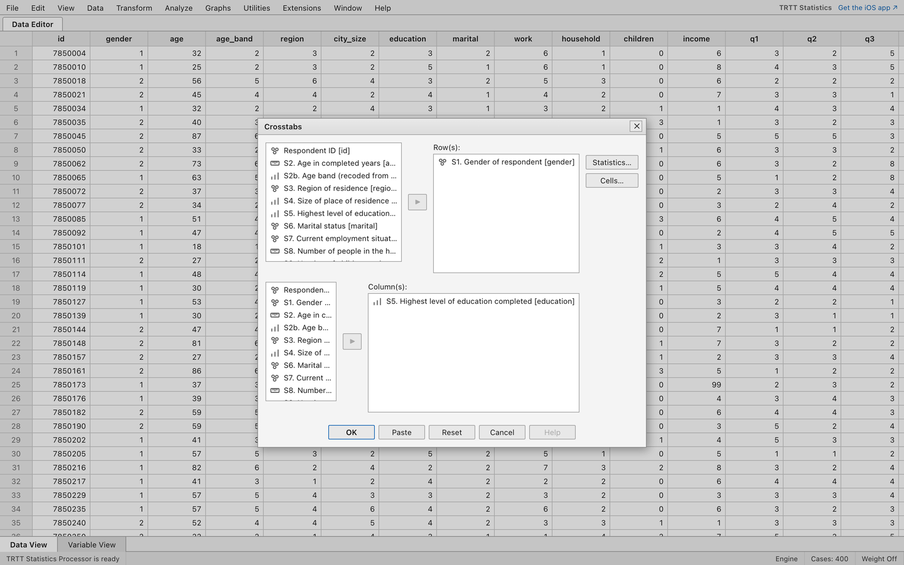
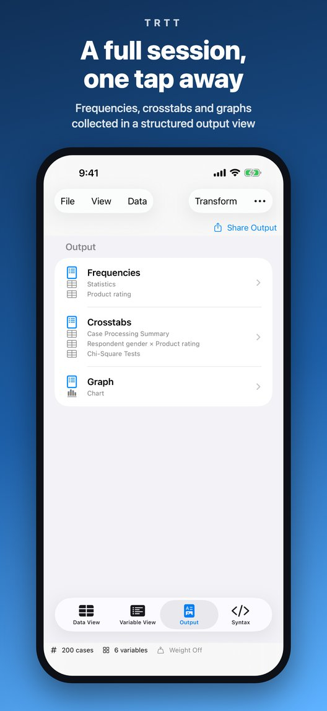
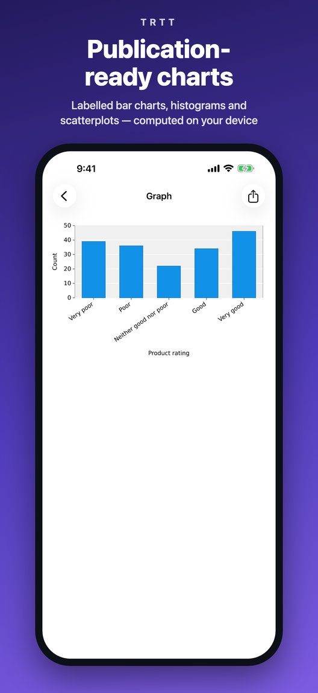
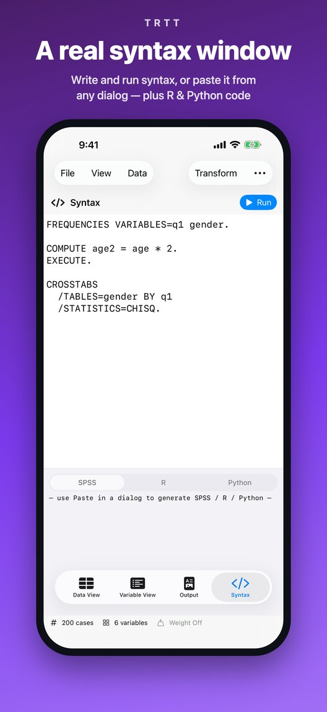
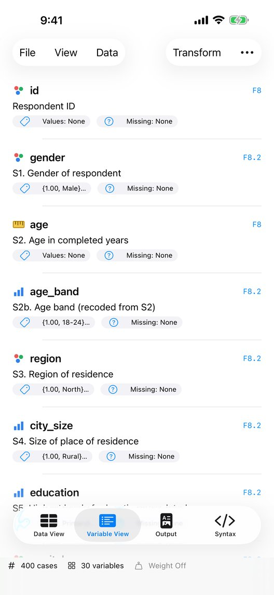

# TRTT – a free SPSS alternative for the browser, iPhone and iPad

**TRTT Statistics** works like IBM SPSS Statistics: the same Data View and Variable View, the same Analyze menu, the same output tables, and a Syntax window that runs SPSS command syntax. Open your `.sav` files, run crosstabs, t-tests, ANOVA or regression, and get SPSS-style output.

- **Web: free, no account, nothing to install** → **[trtt.app](https://trtt.app/)**
- **iPhone and iPad** → **[TRTT on the App Store](https://apps.apple.com/app/id6792289585?ct=github)**

This repository is the public home of TRTT: bug reports, feature requests and release notes. The source code is not public at this time.

## Why TRTT

- **Familiar if you learned SPSS.** Menus follow SPSS 32 (Analyze ▸ Descriptive Statistics ▸ Crosstabs…, Compare Means and Proportions, General Linear Model …), so what you learned in class still works.
- **Your data stays on your device.** The statistics engine is written in Rust and runs locally: as WebAssembly inside your browser on the web, natively on iOS. Data files are not uploaded to a server.
- **Same engine, same numbers everywhere.** The web app and the iOS app share one engine, so the same file gives the same results and the same charts on both.
- **Tested for SPSS compatibility.** Results are checked against PSPP and the published IBM SPSS algorithms. TRTT is a separate product and does not claim to be identical to SPSS in every detail.

## Screenshots

| Data Editor                                                                    | Crosstabs dialog                                                                       |
| ------------------------------------------------------------------------------ | -------------------------------------------------------------------------------------- |
|  |  |

| iPhone: Output | iPhone: charts | iPhone: Syntax | iPhone: Variable View |
|---|---|---|---|
|  |  |  |  |

## What it does

**Data files**
- Open and save SPSS `.sav` files; the web app also opens compressed `.zsav`.
- Keeps variable labels, value labels, missing values (discrete and ranges), formats, measurement level, long names, very long strings, multiple response sets and attributes.
- Import CSV, TSV, TXT and Excel (`.xlsx`); export data to CSV and Excel, with values or value labels.

**Procedures** (Analyze menu)
- Descriptive statistics: Frequencies, Descriptives, Explore, Crosstabs (with chi-square), Ratio
- Compare means: Means, one-sample, independent-samples and paired-samples t tests, One-Way ANOVA
- General Linear Model: Univariate
- Correlate: bivariate correlations
- Regression: linear and ordinal
- Classify: TwoStep, K-Means and hierarchical cluster analysis, discriminant analysis, nearest neighbor
- Dimension reduction: factor analysis
- Scale: reliability analysis (Cronbach's alpha)
- Nonparametric tests (legacy dialogs): chi-square, binomial, runs, one-sample K-S, 2 and K independent samples, 2 and K related samples
- Graphs: Chart Builder and legacy charts

**Transformations and data management**
Compute, Count, Recode, Autorecode, Rank, Replace Missing Values, Shift Values, Sort Cases, Split File, Select Cases, Weight Cases.

**SPSS syntax**
- Syntax window: open and save `.sps` files and run them.
- **Paste** in the dialogs writes the SPSS syntax for you, plus equivalent R and Python code.
- Supported commands include FREQUENCIES, DESCRIPTIVES, EXAMINE, CROSSTABS, MEANS, T-TEST, ONEWAY, UNIANOVA, CORRELATIONS, REGRESSION, PLUM, FACTOR, RELIABILITY, NPAR TESTS, CLUSTER, QUICK CLUSTER, TWOSTEP CLUSTER, DISCRIMINANT, KNN, MULT RESPONSE, GRAPH, GGRAPH, COMPUTE, IF, DO IF / ELSE IF / END IF, RECODE, COUNT, RANK, AUTORECODE, AGGREGATE, SELECT IF, FILTER, SPLIT FILE, WEIGHT, SORT CASES, and the dictionary commands (VARIABLE LABELS, VALUE LABELS, MISSING VALUES, FORMATS, RENAME VARIABLES, ALTER TYPE …), with `TO` ranges such as `q1 TO q8`.
- Not supported yet: LOOP, DO REPEAT, VECTOR, MATCH FILES, ADD FILES, DATASET, TEMPORARY, LOGISTIC REGRESSION, CTABLES, MIXED, multivariate GLM, macros (DEFINE) and BEGIN PROGRAM.
- Full list with examples: [SPSS syntax online](https://trtt.app/guides/spss-syntax-online/). The newest syntax additions (IF, DO IF, AGGREGATE, `TO` ranges) are live on the web and coming to the iOS app in the next update.

**Output**
SPSS-style pivot tables and charts in an output viewer. Export the whole output to `.spv`; copy tables into Word or Excel; save charts as images. The iOS app also exports PDF.

## Platforms and pricing

| | Web ([trtt.app](https://trtt.app/)) | iPhone and iPad ([App Store](https://apps.apple.com/app/id6792289585?ct=github)) |
|---|---|---|
| Price | Free | Free download; all features work on datasets up to 100 cases. TRTT Pro (weekly, monthly or one-time lifetime purchase) removes the limit. Prices are shown in the app. |
| Account | Not needed | Not needed |
| Where data is processed | In your browser | On your device |
| Requirements | A modern desktop browser (Chrome or Edge recommended for saving files in place) | iOS / iPadOS 17 or later |

There is no Android app.

## Guides

- [Free SPSS alternatives](https://trtt.app/alternatives/free-spss-alternatives/)
- [SPSS alternative online](https://trtt.app/alternatives/spss-alternative-online/)
- [TRTT vs PSPP](https://trtt.app/compare/trtt-vs-pspp/)
- [Is SPSS free for students?](https://trtt.app/guides/is-spss-free-for-students/)
- [SPSS trial expired: what now?](https://trtt.app/guides/spss-trial-expired/)
- [How to open a .sav file without SPSS](https://trtt.app/guides/open-sav-file-without-spss/)
- [Open an SPSS .sav file on iPhone or iPad](https://trtt.app/guides/open-sav-file-on-iphone-ipad/)
- [Convert .sav to CSV or Excel](https://trtt.app/guides/convert-sav-to-csv-excel/)
- [Chi-square test without SPSS](https://trtt.app/guides/chi-square-test-without-spss/) · [t-test without SPSS](https://trtt.app/guides/t-test-without-spss/) · [Cronbach's alpha without SPSS](https://trtt.app/guides/cronbach-alpha-without-spss/)
- [All guides and comparisons](https://trtt.app/alternatives/)

## Feedback and bug reports

Found a difference from SPSS, a crash, or a command you need? [Open an issue](../../issues/new/choose). For a wrong result, attach the syntax you ran and, if you can, a small `.sav` file that shows the problem (please remove personal data first).

Contact: contact@trtt.app

## Source code

The source code is not public at this time. This repository holds issues and release notes only.

---

TRTT is an independent product. It is not affiliated with or endorsed by IBM. IBM and SPSS are trademarks of International Business Machines Corporation.
