# TRTT press kit

TRTT is a statistics app with an interface nearly identical to SPSS, so SPSS users can switch without relearning anything. It opens .sav files, runs SPSS syntax and the analyses taught in research methods courses. The web version is free and needs no install or account; a native app runs on iPhone and iPad.

- **Web:** https://trtt.app (free, no account)
- **iPhone and iPad:** https://apps.apple.com/app/id6792289585 (free download; TRTT Pro in-app purchase removes the 100-case limit)
- **Current iOS version:** 1.3.0, released 5 October 2026

## Downloads

- [Everything in one ZIP](TRTT-press-kit.zip) (5.5 MB: screenshots, icon, fact sheet)
- [Fact sheet (PDF, 1 page)](TRTT-fact-sheet-en.pdf)
- [App icon, 1024 × 1024 px](trtt-icon-1024.png)

## Screenshots

### Web

| Data View with value labels | Crosstabs dialog | Crosstabs output |
|---|---|---|
| 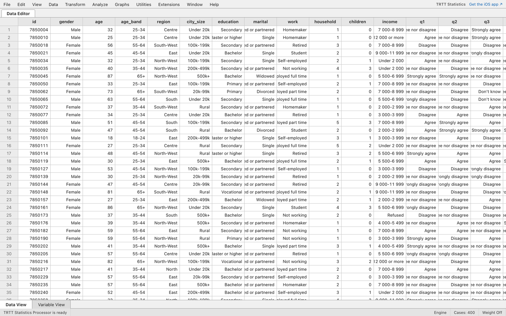 |  | 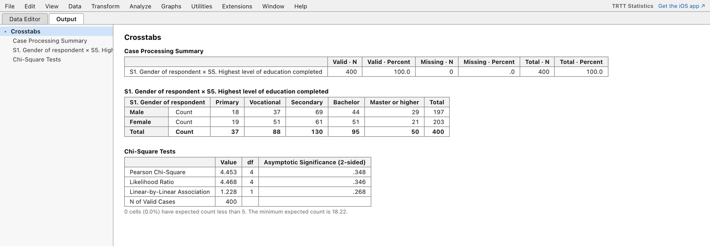 |

### iPad

| Data View with value labels | Crosstabs | Chart with panels |
|---|---|---|
| 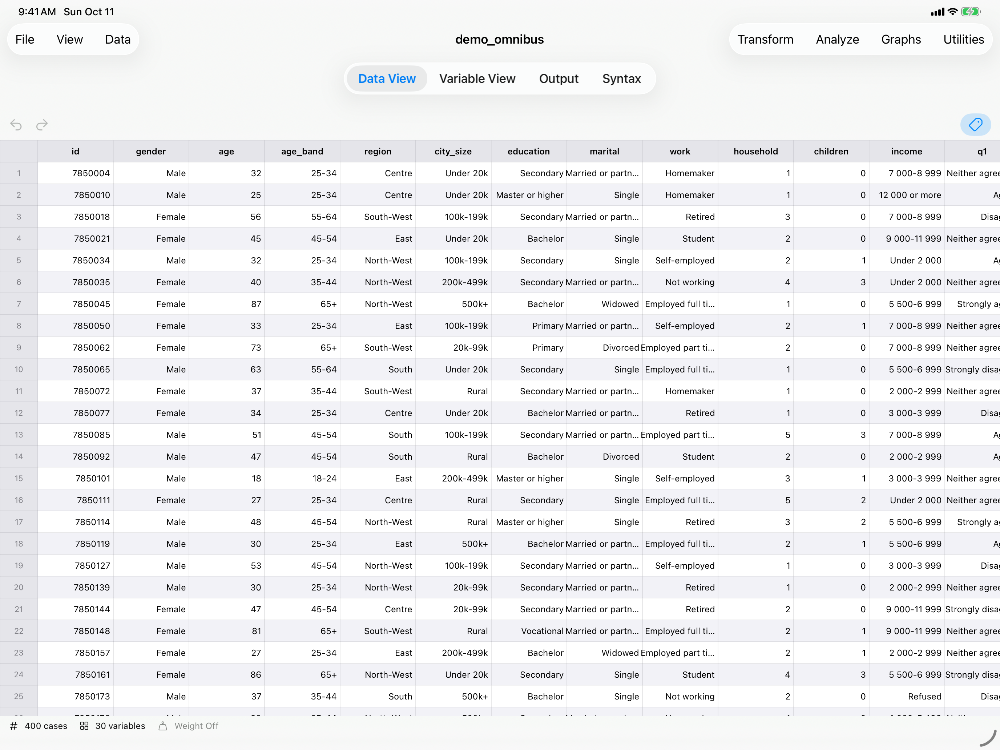 | 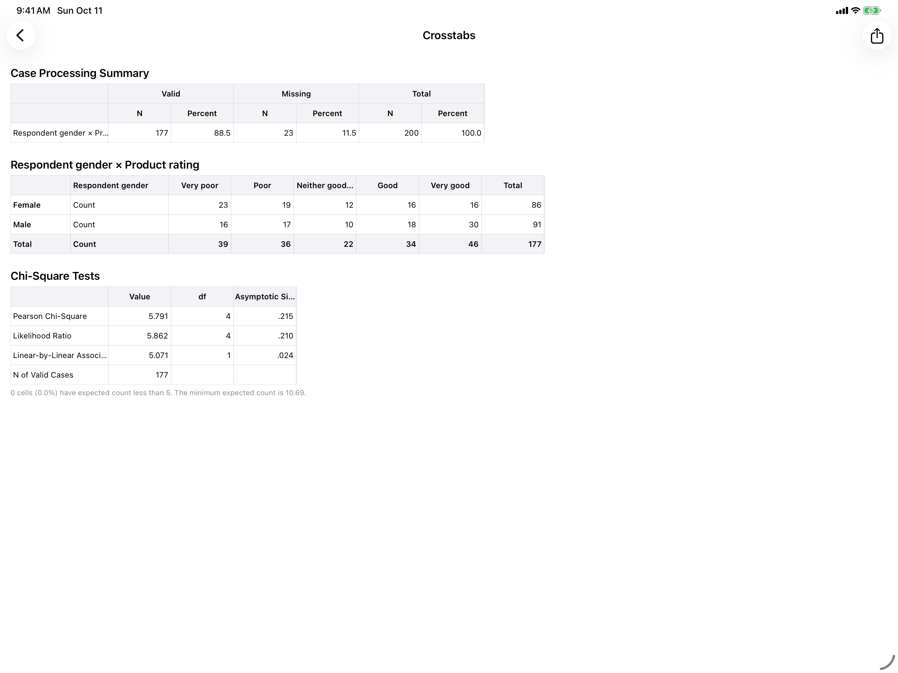 | 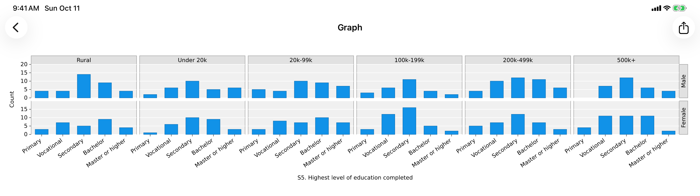 |

Portrait: [Data View](screenshots/ipad-2-data-labels-portrait.png) · [Crosstabs](screenshots/ipad-3-crosstabs-portrait.png)

### iPhone

| Data View | Variable View | Value labels | Output | Chart | Syntax |
|---|---|---|---|---|---|
| 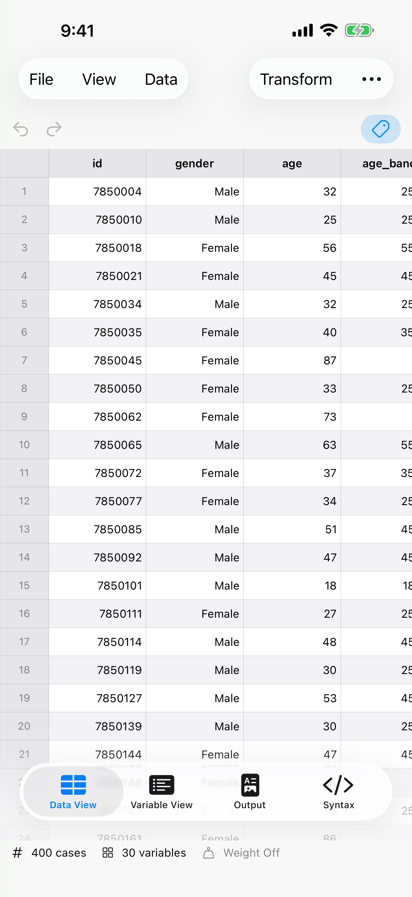 | 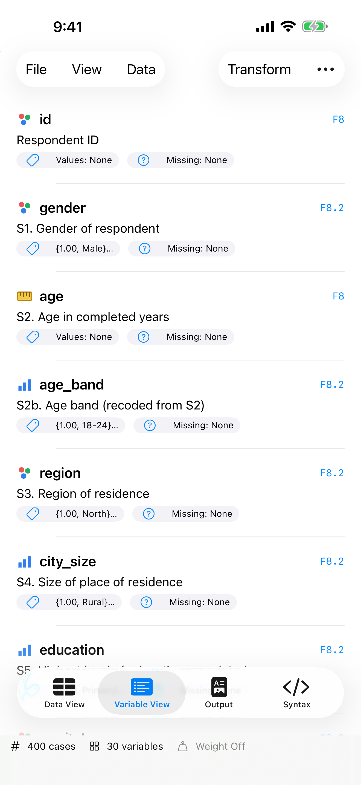 | 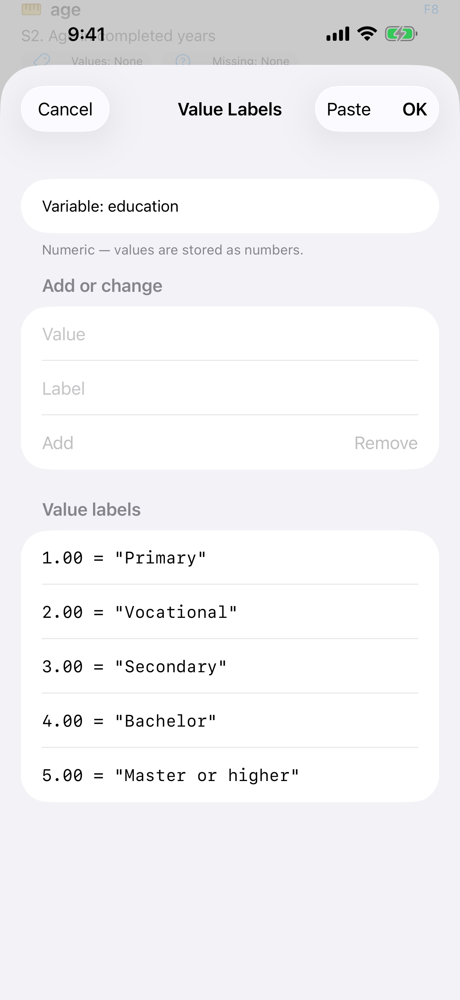 | 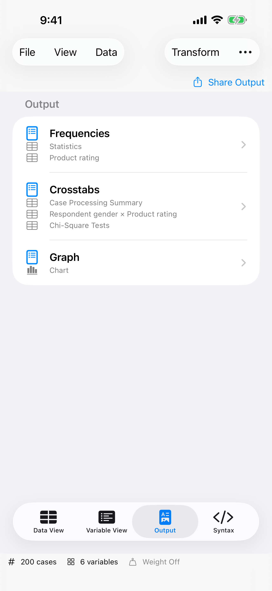 | 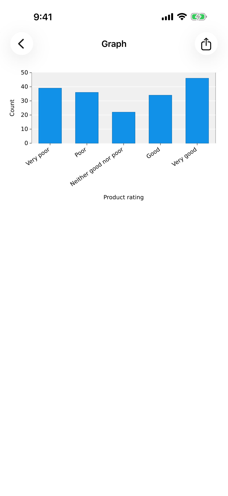 | 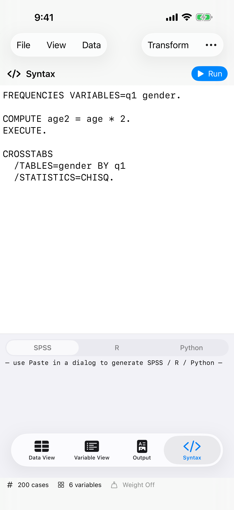 |

Landscape: [Data View](screenshots/iphone-4-data-view-landscape.png)

## Press contact

Rafał Rybnik – contact@trtt.app

TRTT is not affiliated with IBM. IBM and SPSS are trademarks of International Business Machines Corporation.
